# EdgeRunner Proposal Graphics Catalog

Single-source reference for every proposal graphic produced under [federal-proposal-assistant/proposals/](../proposals/). The library section below is the curated reusable set; the proposal-specific section holds one-offs kept for fork-and-customize starts.

> **Audience note.** This catalog is the proposal-team-facing detailed reference. For the **company-wide team-facing view**, see [LIBRARY-README.md](LIBRARY-README.md) (intro + usage for non-proposal teammates) and [index.html](index.html) (thumbnail gallery — open in browser). The Drive-hosted copy of this library mirrors the same three files. Contribution flow is in [CONTRIBUTING.md](CONTRIBUTING.md).

**How to use this:**
1. Starting a new proposal? Scan the **Library** table first — odds are 50%+ of your needed figures already exist.
2. The canonical `source.html` + `data.json` live in `_library/<pattern>/`. The PNG preview is `preview.png` next to them.
3. If a pattern fits but needs different labels/data, copy the canonical into the new proposal's `graphics/` folder and edit there. Do not edit the canonical in place.
4. If you build something genuinely new and reusable, promote it from `_proposal-specific/` into `_library/` with a README.

**Maintenance:**
- When a new "winner" version of a pattern emerges, update `canonical_source` in the README frontmatter and refresh `source.html`/`preview.png`. Keep the previous proposal-specific copy under `_proposal-specific/`.
- The frontmatter shape (pattern, tags, canonical_source, used_in, dimensions, last_updated) is the contract — `/proposal-graphics` will read it when it's wired up (Option C). Don't drop fields.

---

## Library — Canonical Reusable Patterns

| Preview | Pattern | Used in | When to reach for it |
|---|---|---|---|
| [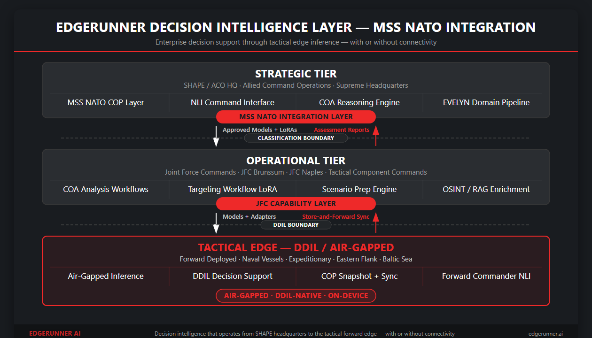](_library/three-tier-architecture/) | [three-tier-architecture](_library/three-tier-architecture/) | nato-diana, ae-mmp, ngb, vulcan, digital-guardian-sim, socpac | Any architecture section establishing enterprise/edge/tactical tiers |
| [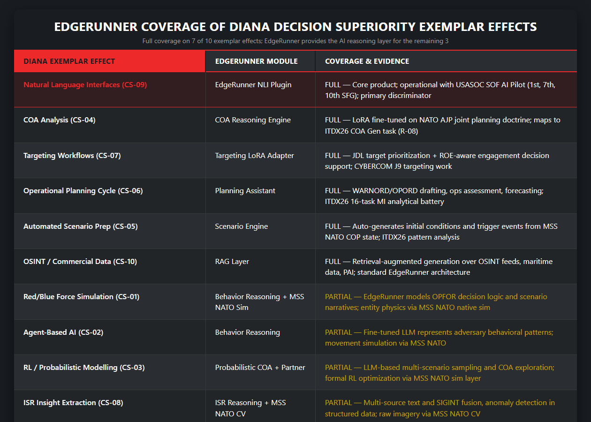](_library/capability-matrix/) | [capability-matrix](_library/capability-matrix/) | nato-diana, socpac, ae-mmp, digital-guardian-sim, ngb | Requirements×capabilities traceability when compliance is a discriminator |
| [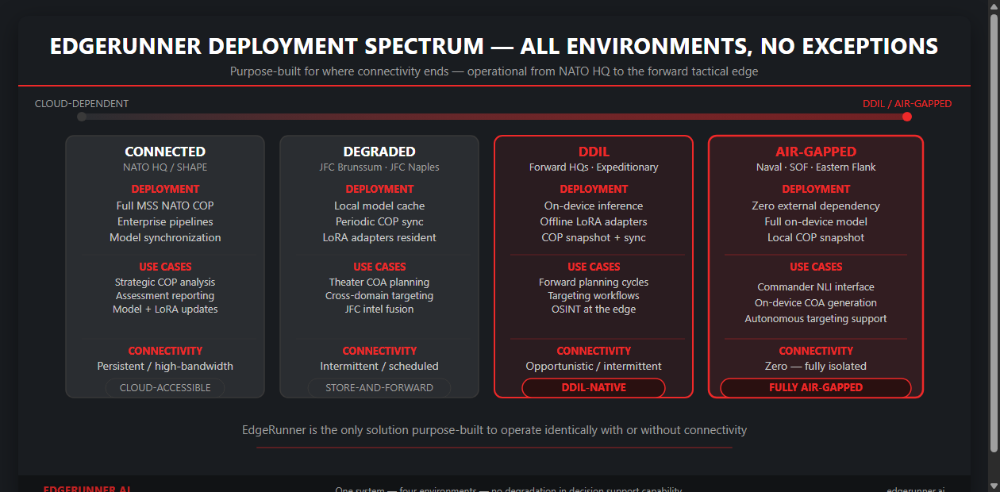](_library/deployment-spectrum/) | [deployment-spectrum](_library/deployment-spectrum/) | nato-diana, extic-26-2, ae-mmp | Connected → DDIL → air-gapped story; ghost cloud-tethered competitors |
| [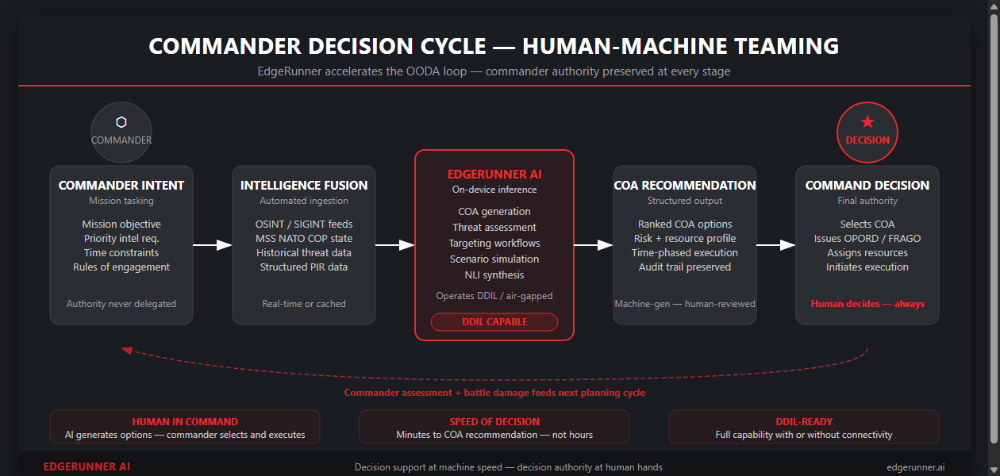](_library/human-machine-teaming/) | [human-machine-teaming](_library/human-machine-teaming/) | nato-diana, ae-mmp | Operator-in-the-loop / oversight win themes |
| [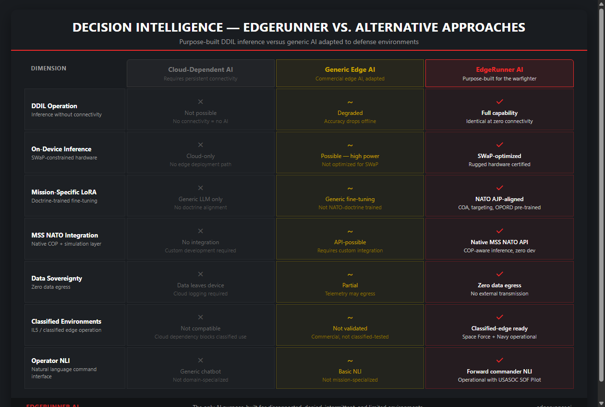](_library/differentiator-comparison/) | [differentiator-comparison](_library/differentiator-comparison/) | nato-diana, ae-mmp | Side-by-side vs. named alternatives (never generic) |
| [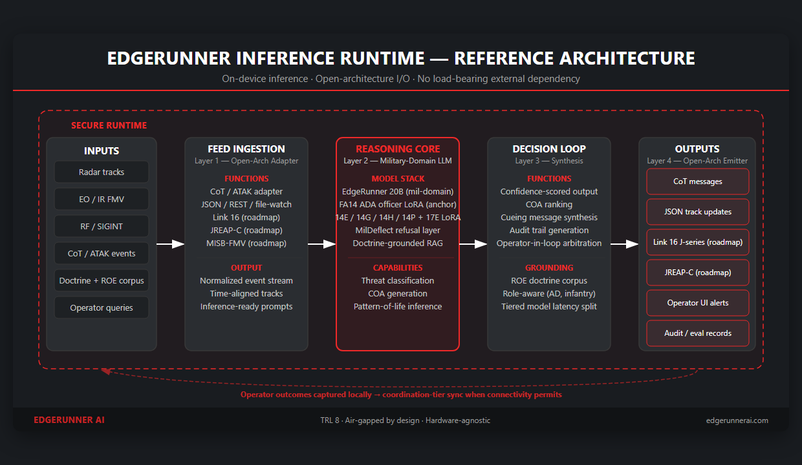](_library/platform-architecture/) | [platform-architecture](_library/platform-architecture/) | extic-26-2, ae-mmp | Technical component block diagram for evaluators with depth |
| [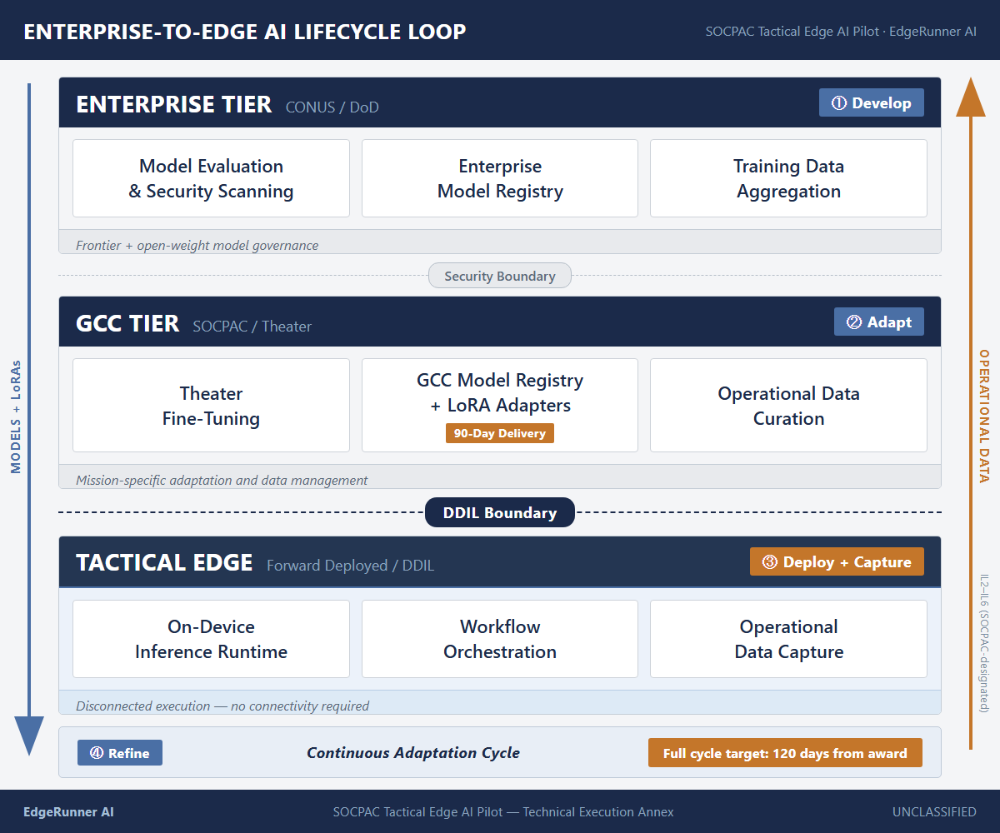](_library/lifecycle-loop/) | [lifecycle-loop](_library/lifecycle-loop/) | socpac, digital-guardian-sim, ngb, vulcan | MLOps / continuous-improvement / sustainment requirements |
| [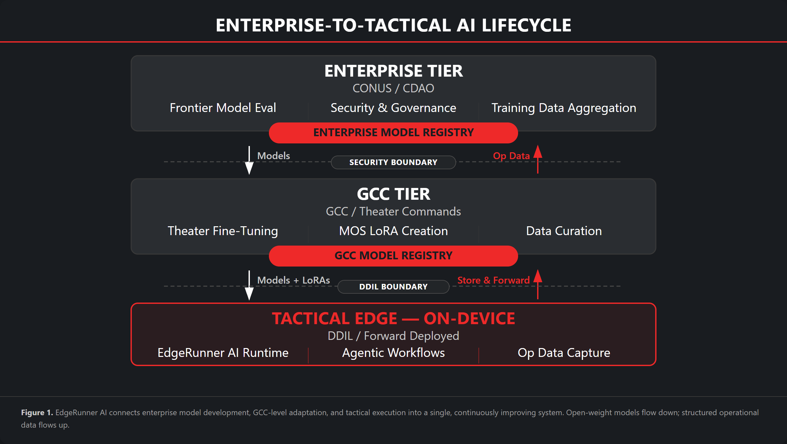](_library/enterprise-tactical-lifecycle/) | [enterprise-tactical-lifecycle](_library/enterprise-tactical-lifecycle/) | dod-openweight, socpac | Enterprise-trained → tactical-deployed model handoff |
| [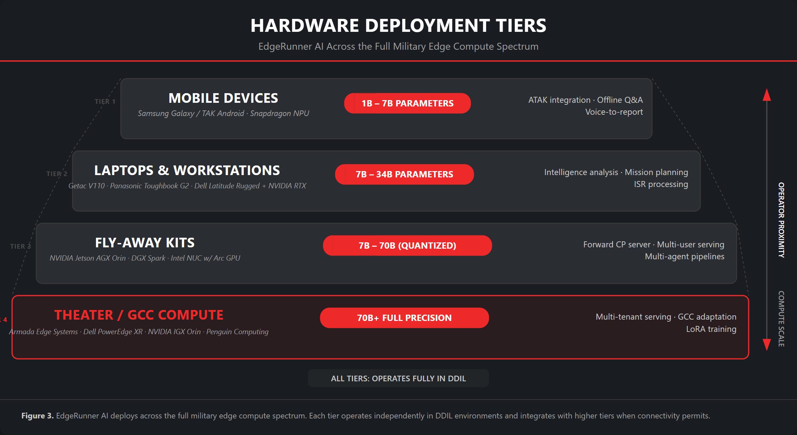](_library/hardware-tiers/) | [hardware-tiers](_library/hardware-tiers/) | dod-openweight, socpac | Justifying compute BOM / defending "no GPU farm" claim |
| [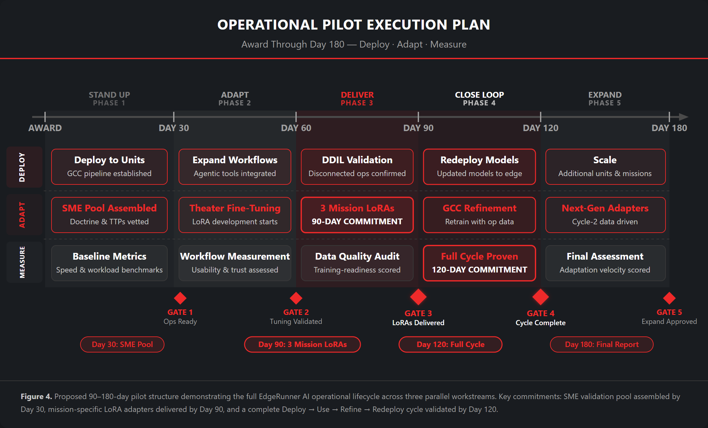](_library/pilot-schedule/) | [pilot-schedule](_library/pilot-schedule/) | dod-openweight, socpac, vulcan, digital-guardian | Quarter-scale pilot / integration schedule (swimlane Gantt) |
| [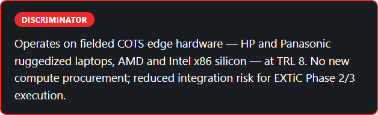](_library/callout-template/) | [callout-template](_library/callout-template/) | extic-26-2 | Sidebar callouts (discriminator/proof/commitment/definition/impact) |

## Proposal-Specific — Forkable Starting Points

Custom figures tied to specific programs. Reuse the structure, not the labels.

### Vulcan / JATF
- [vulcan-system-architecture](_proposal-specific/vulcan-system-architecture/) — JATF system block diagram
- [vulcan-evelyn-loop](_proposal-specific/vulcan-evelyn-loop/) — EVELYN data labeling loop
- [vulcan-requirements-matrix](_proposal-specific/vulcan-requirements-matrix/) — JATF-specific compliance grid
- [vulcan-integration-timeline](_proposal-specific/vulcan-integration-timeline/) — JATF integration phases
- [vulcan-operational-timeline](_proposal-specific/vulcan-operational-timeline/) — JATF ops rollout

### Senate Briefings (PRC Open-Source Models)
- [senate-prc-two-tier-race](_proposal-specific/senate-prc-two-tier-race/) — US/PRC two-tier framing
- [senate-prc-operator-reality](_proposal-specific/senate-prc-operator-reality/) — operator-level view
- [senate-prc-vendor-provenance](_proposal-specific/senate-prc-vendor-provenance/) — supply-chain provenance
- [senate-prc-agentic-stack](_proposal-specific/senate-prc-agentic-stack/) — agentic AI stack diagram

### Senate Briefings (Manchurian Models)
- [senate-manchurian-threat-lifecycle](_proposal-specific/senate-manchurian-threat-lifecycle/) — threat lifecycle
- [senate-manchurian-containment](_proposal-specific/senate-manchurian-containment/) — containment architecture

### EXTIC 26-2
- [extic-workflow](_proposal-specific/extic-workflow/) — EXTIC end-to-end workflow
- [extic-decision-node](_proposal-specific/extic-decision-node/) — decision node detail (v4)
- [extic-callouts](_proposal-specific/extic-callouts/) — five filled-in callouts + contact sheet (template lives in `_library/callout-template`)

### DoD Open-Weight Whitepaper
- [dod-openweight-resort](_proposal-specific/dod-openweight-resort/) — fig1 "resort" (v9 final)
- [dod-openweight-enterprise-to-edge](_proposal-specific/dod-openweight-enterprise-to-edge/) — fig2

### SOCPAC
- [socpac-workflow-arch](_proposal-specific/socpac-workflow-arch/) — SOCPAC PaceSetter workflow

### Digital Guardian Sim
- [digital-guardian-architecture](_proposal-specific/digital-guardian-architecture/)
- [digital-guardian-personas](_proposal-specific/digital-guardian-personas/)
- [digital-guardian-why-dashboard](_proposal-specific/digital-guardian-why-dashboard/)
- [digital-guardian-schedule](_proposal-specific/digital-guardian-schedule/)
- [digital-guardian-session-lifecycle](_proposal-specific/digital-guardian-session-lifecycle/)

### Single-Figure Proposals
- [itdx26-architecture](_proposal-specific/itdx26-architecture/) — Army FCC/ICED AI Analyst architecture
- [mystic-depot-unified-arch](_proposal-specific/mystic-depot-unified-arch/) — DIU CSO LOE1 unified architecture (PNG only)

---

## Provenance & Notes

- **Canonical picks** favored the most recent polished version. Where the workspace root [graphics/](.) held a newer May 5 polish (fig3-5), that won over the NATO-DIANA May 4 versions in `proposals/nato-diana-decision-superiority/graphics/`.
- **Not promoted to library** (yet, but candidates): EXTIC v5 deployment-spectrum is structurally distinct from the canonical and may earn its own pattern if a third proposal uses that framing.
- **Superseded versions** in proposal folders (`_superseded/`, `_v1-archive/`, `run-backup-*/`) were not pulled here. The canonical library is forward-only; archive lives with the originating proposal.
- **Originals are untouched.** This library is additive — every proposal still owns its `graphics/` folder. Nothing was moved or deleted.
